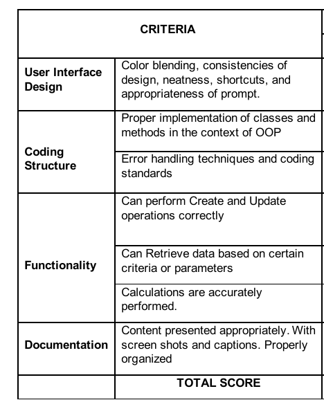

# Student-Grade-Record-Sample-Java-OOP-Project
A student grade management system that handles well... As you may have guessed, their fuckass grades

----
### Leche Plan

**Inclusion in the simple system:**
- Apply Java GUI components and OOP
- Should be able to input data using a class (ex. Student Record, Employee Record, etc.)
- Transactions processing shall be included
- Apply Array of Records or ArrayList

**System Functions:**
- Add and update student record
- view summary of student grades
- modify student records
- Search for students
- Sort Students by marks
- Exit

**Inspiration**
- [Student Record System using Java Swing - GeeksforGeeks](https://www.geeksforgeeks.org/java/student-record-system-using-java-swing/)
- [Build a Student Management System Using Java & MySQL | by charan sai | Medium](https://medium.com/@charansai.ashokit/build-a-student-management-system-using-java-mysql-a41be0bb09f3)
